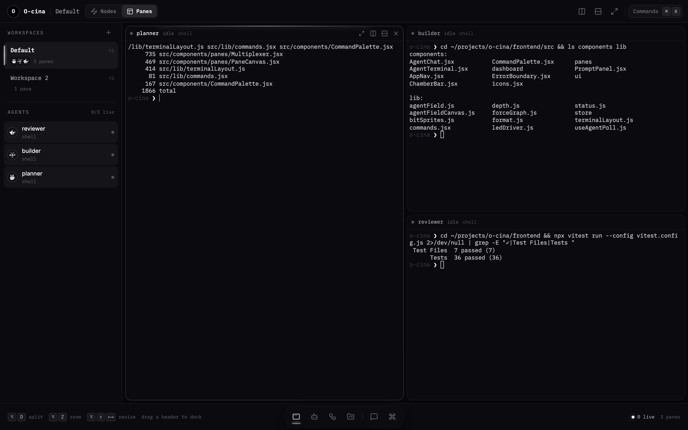
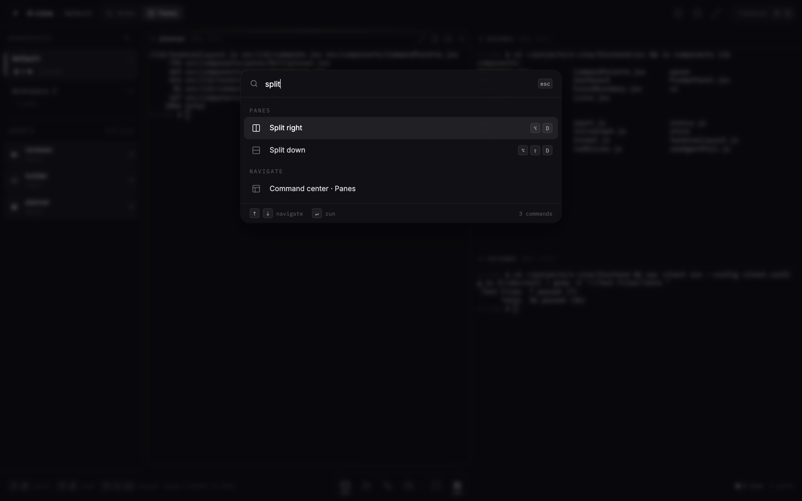
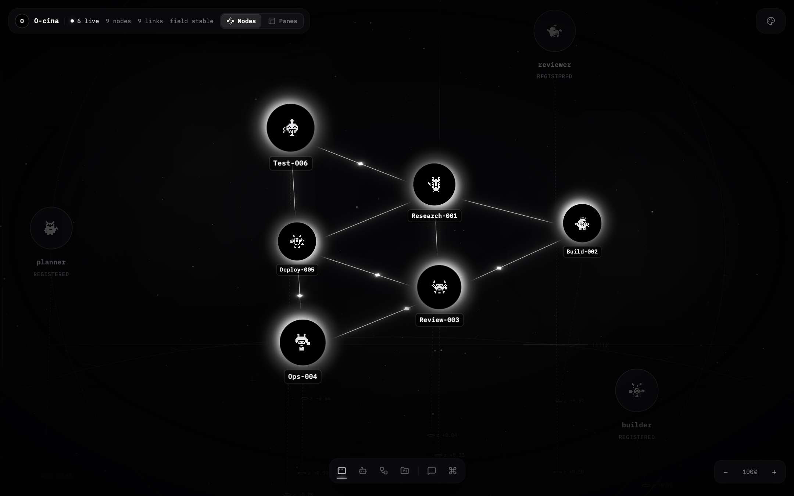
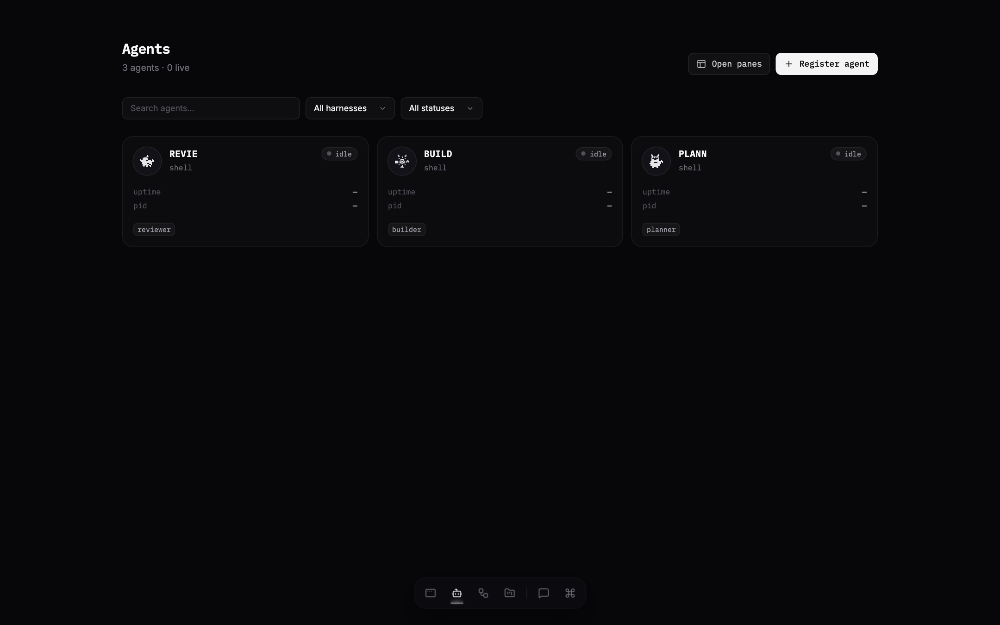
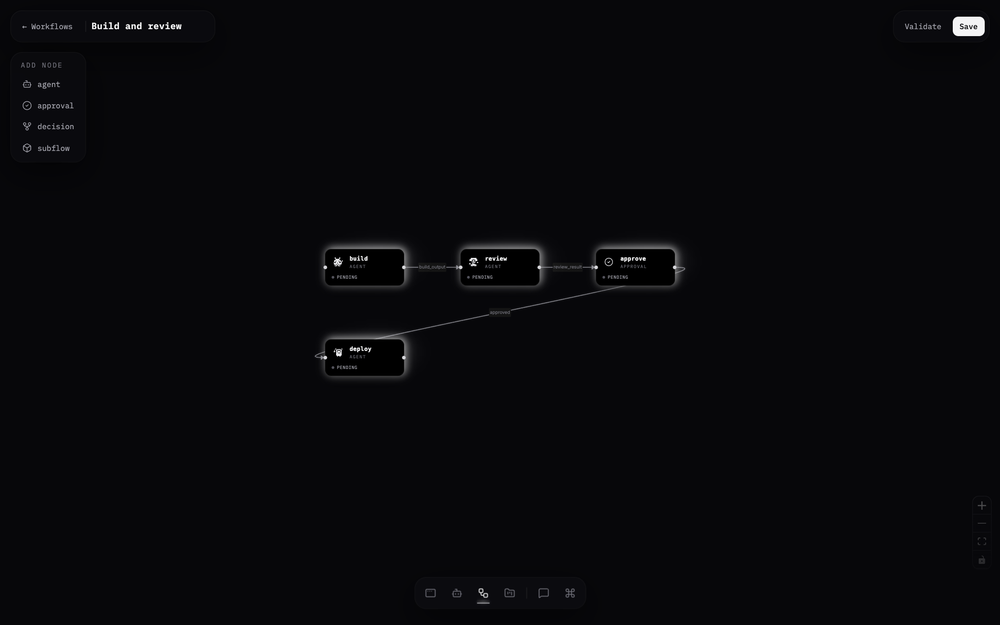
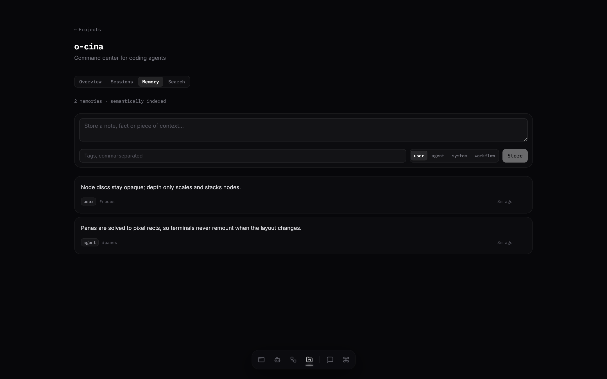
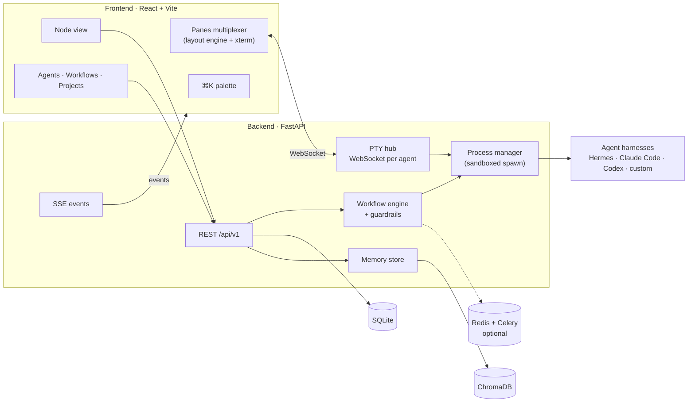

# O-cina

**An expanded terminal multiplexer for AI coding agents.**

O-cina (*Open Officina*, "open workshop") gives you split panes and workspaces like tmux or cmux, but every pane is an *agent*, not just a shell. Run Hermes, Claude Code, Codex or your own harness side by side. It keeps their processes alive, tells you which ones need attention, and adds the things a plain multiplexer can't: agent lifecycle control, DAG workflows with guardrails, a shared project memory, a ⌘K command palette, and a live node view of how your agents connect.

It runs locally on **macOS and Linux**. It's framework-agnostic and MIT licensed.



---

## Contents

- [Why O-cina](#why-o-cina)
- [Features](#features)
- [Quick start](#quick-start)
- [Keyboard shortcuts](#keyboard-shortcuts)
- [Configuration](#configuration)
- [Architecture](#architecture)
- [API](#api)
- [CLI](#cli)
- [Development](#development)
- [Status and limitations](#status-and-limitations)
- [License](#license)

---

## Why O-cina

Running several coding agents at once usually means a pile of terminal tabs. Each tab has its own process, you can't easily see which agent is stuck, and nothing is shared between them. O-cina keeps the terminal-first workflow but makes the multiplexer aware of what's running inside it:

| | tmux / cmux | **O-cina** |
|---|---|---|
| Split panes and named workspaces | ✓ | ✓ resizable, drag-to-dock, animated |
| Panes know which agent they hold | — | ✓ status, harness and attention rings per pane |
| Start / stop / restart the process behind a pane | manual | ✓ from the pane, palette, UI, CLI or API |
| One session shared by terminal *and* GUI chat | — | ✓ a PTY per agent; GUI input mirrors into the pane |
| Workflows across agents (DAG, approvals, budgets) | — | ✓ |
| Shared memory across agents and chats | — | ✓ semantic project memory, injected into prompts |
| Overview of the whole system | — | ✓ live node view of agents and their links |
| Scriptable | ✓ | ✓ REST API, SSE events, CLI |

## Features

### Panes: the multiplexer

The core of O-cina is a pane multiplexer built for agents.

- **Workspaces.** Named layouts, shown as vertical tabs (cmux-style). Each tab shows its agents, pane count and how many are live, plus an amber dot when an agent in it needs attention. Switch with `⌥1`–`⌥9`.
- **Agent panes.** Every pane attaches to an agent's PTY over a WebSocket. One PTY is shared by every client, so the same session appears in the pane, on the agent page and in the GUI chat. A pane whose agent errors or stalls gets an amber attention ring.
- **Fluid layout engine.** The split tree is solved to pixel rectangles and every pane is absolutely positioned:
  - Dividers resize live, and once a pane reaches its minimum size they push the next pane along.
  - Splits in the same direction share one row, so a single drag moves across all of them.
  - Splitting, closing, zooming and evening out all glide instead of jumping.
  - A pane's terminal is never remounted by a layout change, so sessions don't drop.
- **Drag to dock.** Grab a pane header and drop it on another pane's edge to dock it there, or in the centre to swap the two. A live preview shows where it will land.
- **Zoom.** Lift one pane to fill the workspace and restore it without losing state.
- **Smart refit.** Terminals reflow smoothly while you drag. The program inside is told its new size only once the size settles, so a TUI redraws once instead of on every frame.
- **Persistence.** Workspaces and layouts are saved in the browser and restored on reload.

### ⌘K command palette



Every action is one keystroke away, on every page, even while a terminal has focus. That covers opening any agent in a pane, splitting, zooming, closing, evening out, switching workspaces, starting, stopping or restarting the focused agent, and jumping to any agent, workflow or project. Each page adds its own commands to the palette.

### Node view



The node view lays out every agent with a force-directed layout:

- **Live agents** glow with a cursor-reactive edge light. **Idle agents** are dimmed.
- **Links** between agents that share workflows or tasks carry travelling pulses.
- **Depth.** The view has a parallax starfield, depth-scaled floating nodes, and a minimal monochrome line HUD: an orbit ring, depth stems and datum lines.
- **Controls.** Pan with drag (or space + drag) and zoom with the wheel. Click a node for its details, including load, current task and routes.

When no agent is running, the field shows a small set of clearly marked preview nodes, so the view never looks empty.

### Agents



- **Register** any harness with a name, model, provider and skills.
- **Lifecycle:** start, stop and restart agents.
- **Agent page:** live logs, process metrics, configuration, and Chat / Terminal tabs that share one session.
- **Sandboxing:** processes run in their own session with a scrubbed environment and per-process CPU and memory limits (`RLIMIT_*`, best-effort on macOS).
- **Health:** agents send heartbeats. With the optional Celery worker running, agents that go quiet are marked offline.
- **Discovery:** O-cina detects installed harnesses (`hermes`, `claude`, `codex`) on the machine.
- **Adapters:** Hermes ships with a built-in adapter that launches its CLI inside the PTY. Any other harness opens a login shell in its PTY, so you can run `claude`, `codex` or anything else there. New adapters plug in through `backend/app/adapters/`.

### Workflows



- **Visual DAG editor** with four node types: agent, approval, decision and subflow.
- **Guardrails** enforced while a workflow runs:
  - loop detection (`max_iterations`)
  - per-task timeouts
  - approval gates, which pause a run until you approve
  - token and cost budgets
- **Starter templates:** Sequential, Build and Review, and Fan-out / Fan-in.
- **Runs:** validate, run, stop and approve from the editor, the CLI or the API.

### Projects and shared memory



- **Projects** group sessions and agents.
- **Memory bank.** Each project has a semantically indexed memory bank, stored in local ChromaDB with `all-MiniLM-L6-v2` embeddings.
- **Memory in prompts.** When you prompt an agent with a project linked, the most relevant memories are retrieved and passed to it wrapped in `<memory_bank>` tags, so context carries across chats and agents.
- **Search.** Search memories by meaning, filtered by source.

### Prompt from anywhere

The talk button in the floating nav opens a prompt composer over any page. Pick an agent and a project memory bank, then send. The reply appears in a chat transcript.

---

## Quick start

### Requirements

- macOS or Linux
- Python 3.11+ (3.12 recommended)
- Node.js 20+
- Redis (optional; needed only for Celery heartbeat and reaper jobs)

### 1. Backend

```bash
git clone https://github.com/Kristianaaron/o-cina.git
cd o-cina
chmod +x run scripts/*.sh
./run
```

`./run` creates `.venv`, installs dependencies, applies database migrations and starts the API on **http://127.0.0.1:8002**. Interactive API docs are at `/docs`.

<details>
<summary>Manual backend setup</summary>

```bash
python3 -m venv .venv && source .venv/bin/activate
pip install -r backend/requirements.txt
./scripts/migrate.sh
cd backend && python -m uvicorn app.main:app --host 127.0.0.1 --port 8002
```
</details>

### 2. Frontend

```bash
cd frontend
npm install
npm run dev        # http://localhost:3001 (proxies /api and /health to :8002)
```

Open **http://localhost:3001**, register an agent from **Agents**, then press `⌘K` and choose **Command center · Panes**.

### Production build

```bash
cd frontend && npm run build
rm -rf ../backend/static && cp -R dist ../backend/static
```

The backend then serves the UI at **http://127.0.0.1:8002/static/**.

### Optional infrastructure

```bash
docker compose up -d redis            # Redis only
docker compose --profile full up -d   # Redis + Celery worker
```

---

## Keyboard shortcuts

| Keys | Action |
|---|---|
| `⌘K` / `Ctrl+K` | Command palette (everywhere) |
| `⌥D` / `⌥⇧D` | Split right / split down |
| `⌥W` | Close pane |
| `⌥Z` | Zoom / restore the focused pane (or double-click its header) |
| `⌥]` / `⌥[` | Focus next / previous pane |
| `⌥⇧` + arrow | Push the focused pane's border that way |
| `⌥=` | Even out all panes (double-click a divider for one row) |
| `⌥N`, `⌥1`–`⌥9` | New workspace / switch workspace |
| Drag a pane header | Dock beside another pane, or drop in the middle to swap |
| Right-click a pane | Pane menu |

On Linux, `⌥` is `Alt`. The shortcuts are captured before the terminal sees them, so they work while a pane has focus.

---

## Configuration

Copy `.env.example` to `.env` and adjust as needed.

| Variable | Default | Purpose |
|---|---|---|
| `DATABASE_URL` | `sqlite:///~/.o-cina/data/center.db` | SQLite database |
| `CHROMA_PERSIST_DIR` | `~/.o-cina/data/chroma` | Memory embeddings |
| `OCINA_LOG_DIR` | `~/.o-cina/logs` | Agent process logs |
| `OC_HOST` / `OC_PORT` | `127.0.0.1` / `8002` | API bind address |
| `REDIS_URL` | `redis://localhost:6379/0` | Celery broker (optional) |
| `SECRET_KEY`, `API_KEYS` | none | Auth helpers (see [limitations](#status-and-limitations)) |
| `VITE_PROXY_TARGET` | `http://127.0.0.1:8002` | Backend the dev server proxies to |

| Service | Port |
|---|---|
| Backend API | 8002 |
| Frontend (Vite) | 3001 |
| Redis | 6379 |

---

## Architecture



| Layer | Technology |
|---|---|
| Frontend | React 18, Vite, Tailwind CSS, Redux Toolkit, xterm.js, @xyflow/react, d3-force |
| Backend | FastAPI, SQLAlchemy 2, Alembic, sse-starlette, psutil |
| Storage | SQLite (structured data), ChromaDB (semantic memory) |
| Queue (optional) | Redis + Celery |
| Tests | pytest (backend), Vitest + Testing Library (frontend), Playwright (E2E) |

```
backend/app/
  adapters/       harness adapters (Hermes built in; add your own)
  engine/         workflow engine, guardrails, process manager, discovery
  routers/        REST, SSE and the PTY WebSocket hub
frontend/src/
  components/panes/   multiplexer + layout canvas
  components/ui/      shared UI primitives
  lib/                layout engine, command registry, depth model, store
  pages/              command center, agents, workflows, projects
cli/              `o-cina` command-line client
e2e/              Playwright tests
proto/            agent protocol notes
```

More detail is in [`docs/architecture.md`](docs/architecture.md) and [`proto/agent-protocol.md`](proto/agent-protocol.md).

---

## API

Everything the UI does goes through the API. With the server running, the full interactive reference is at `http://127.0.0.1:8002/docs`.

| Area | Endpoints |
|---|---|
| Agents | `POST /agents/register` · `GET /agents` · `POST /agents/{id}/start\|stop\|restart` · `GET /agents/{id}/logs\|metrics` |
| Terminal | `WS /agents/{id}/terminal` · `POST /agents/{id}/terminal/input` |
| Prompt | `POST /prompt` · `GET /prompt/{task_id}/stream` |
| Workflows | `POST /workflows` · `POST /workflows/{id}/validate\|execute` · `POST …/tasks/{task_id}/stop\|approve` · `GET /workflow-templates` |
| Projects and memory | `POST /projects` · `POST /projects/{id}/memories` · `POST /projects/{id}/memories/search` |
| Sessions | `POST /sessions` · `POST /sessions/{id}/messages` · `GET /search/sessions` |
| Live | `GET /events` (SSE) · `POST /heartbeat` · `GET /health` |

All paths are under `/api/v1` except `/health`.

---

## CLI

```bash
pip install -e .        # or ./bin/o-cina
o-cina status
o-cina agent list
o-cina agent start <id>
o-cina agent logs <id> --follow
o-cina agent prompt <id> "summarise the failing tests"
o-cina workflow run <id>
o-cina project list
```

Run `o-cina --help` for everything.

---

## Development

```bash
# Backend
source .venv/bin/activate
cd backend && pytest tests/ -v && ruff check app/

# Frontend
cd frontend && npm test && npm run build

# End-to-end
cd e2e && npm install && npx playwright test
```

CI runs the backend tests and lint, plus the frontend tests and build, on every push and pull request.

---

## Status and limitations

O-cina is an early, local-first tool (v0.1). Before you rely on it, know that:

- **Auth is off by default.** API-key helpers exist in `backend/app/auth.py`, but routes are open for local use. Don't bind to `0.0.0.0` on an untrusted network without enabling auth.
- **Only Hermes has a built-in adapter.** Other harnesses run in a login shell inside their PTY, which works for any CLI agent but without harness-specific lifecycle hooks.
- **Fan-out nodes run sequentially** for now.
- **The Docker ChromaDB service is optional.** The API uses a local persistent ChromaDB client.

Issues and pull requests are welcome.

## License

[MIT](LICENSE) © Kristian Abenojar
